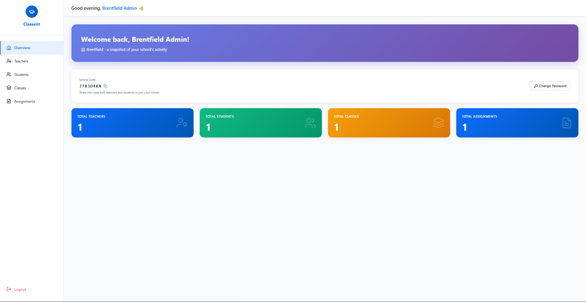
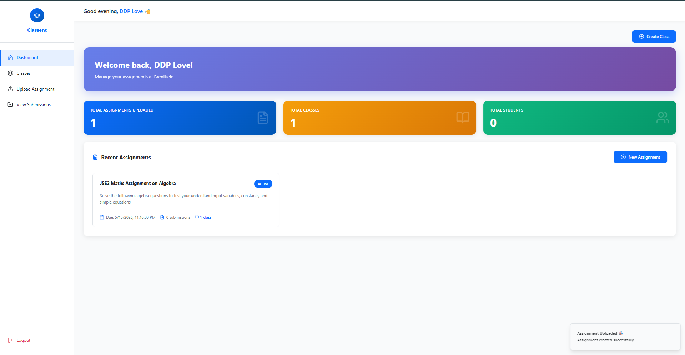
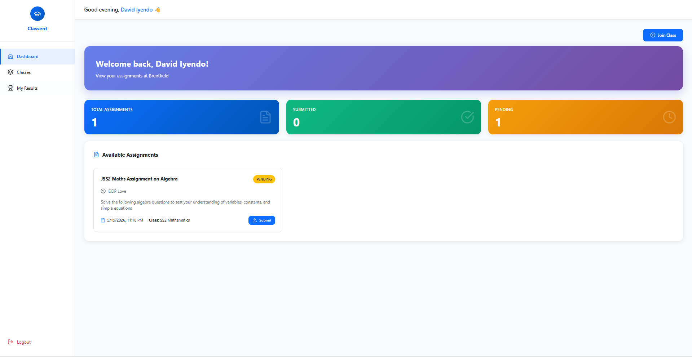

# Classent: School Management SaaS

A multi-tenant school management platform built for how Nigerian schools actually work. Every school gets its own isolated space with its own admin, teachers and students.

🔗 **Live:** [classent.online](https://classent.online)
👤 **My role:** Solo developer (backend, frontend, AI integration)
📍 **Status:** Active, still shipping
🔒 **Source code:** Private. Happy to walk through it on a call.



## The problem
Schools were running assignments, results and communication through WhatsApp groups, printed sheets and spreadsheets. Tools like Google Classroom work per teacher, not per institution.

## What I built
- **Multi-tenant architecture:** every record is scoped to a school, so no data crosses between schools
- **Role-based dashboards:** school admin, teacher and student, each with their own permissions
- **Classes and assignments:** teachers create classes, distribute assignments, and grade submissions
- **AI assignment generation:** a teacher enters a topic (e.g. "Photosynthesis") and Groq (`llama-3.3-70b-versatile`) produces a structured assignment in seconds
- **File handling:** assignment uploads and student submission PDFs stored on Cloudinary
- **Deployment:** Render, with static files served through Whitenoise




## Architecture
```
React + Vite  →  Django REST API  →  PostgreSQL (school-scoped records)
                      │
                      ├── Groq API (AI assignments)
                      └── Cloudinary (PDFs, submissions)
```

## Tech stack
Django · React + Vite · PostgreSQL · Groq API · Cloudinary · Whitenoise · Render

## Roadmap
AI-assisted grading feedback, student performance insights, deeper school-level analytics for admins.
---
[Portfolio case study](https://danieliyendo.netlify.app/portfolio-classent) · [All my work](https://github.com/iyendodaniel) · iyendodaniel4@gmail.com
